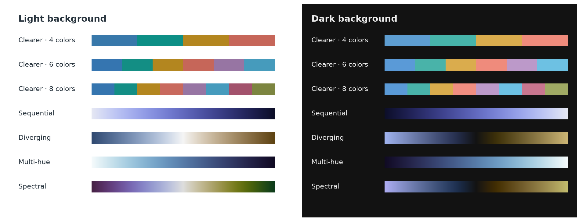
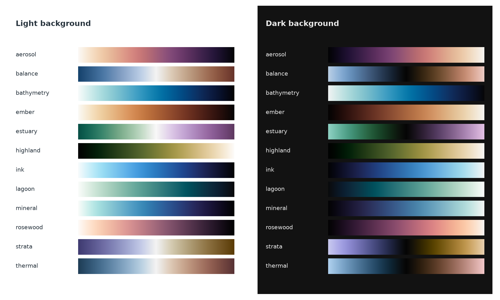

# Huevat

Scientific color palettes and gradients for **Matplotlib, Plotly and UltraPlot**.
Choose colors for categories, continuous fields, or values above and below a center.



Clearer is the default categorical palette. Use `background="dark"` for dark figures.

[Quick start](docs/QUICKSTART.md) · [Plotting examples](examples/README.md) ·
[Figure doctor](docs/FIGURE_DOCTOR.md) · [API guide](docs/API.md)

## Install

From the project folder, choose your plotting library:

```sh
python -m pip install ".[matplotlib]"
python -m pip install ".[plotly]"
python -m pip install ".[ultraplot]"
```

Requires Python 3.10+. For colors alone, use `python -m pip install .`.

## Make a plot

```python
import numpy as np
import matplotlib.pyplot as plt
import huevat as hv
from huevat.adapters import matplotlib as hmpl

x = np.linspace(0, 10, 100)
palette = hv.categorical(5)

fig, ax = plt.subplots()
for i, color in enumerate(palette.colors):
    ax.plot(x, np.sin(x / 2 + i / 3), color=color, label=f"Series {i + 1}")
ax.legend()
plt.show()
```

For a field, pass `hmpl.colormap(hv.sequential())` to `imshow` or `pcolormesh`.
Use `hv.diverging()` with `hmpl.normalizer(vmin, vmax, center=0)` for signed data.


[See complete examples for all three plotting libraries.](examples/README.md)

## More gradients

Twelve additional gradients cover general plots, seismic data, terrain, depth,
and atmospheric fields. These alternatives are experimental.



```python
gradient = hv.gradient("bathymetry")
gradient = hv.gradient("thermal", background="dark")
print(hv.gradient_names())
```

Use `gradient.reversed()` to change direction. For separate colors, try
`gradient.discrete(7)`. Check `hv.known_counts(gradient)` for tested counts.
`hv.optimized_discrete(gradient, n)` searches for better-spaced colors and
requires the `design` extra.

## Figure doctor

Coordinate colors, markers and dashes in an existing figure. Repeated labels
keep the same style across panels.

| Before | After |
| --- | --- |
|  |  |

Install with `python -m pip install ".[design,matplotlib]"`, or replace
`matplotlib` with `plotly` or `ultraplot`.

```python
from huevat import doctor

scene = doctor.inspect(fig)
closer, separation, simple = doctor.propose(scene)
preview = doctor.preview(fig, separation)
change = doctor.apply(fig, separation)
change.undo()
```

[Figure doctor guide](docs/FIGURE_DOCTOR.md) explains previews, fixed colors and
keeping styles across figures. Review the result at the size you intend to use.

## Save colors

```python
hv.export(palette).write("palette.json")
restored = hv.load_export(open("palette.json", encoding="utf-8").read()).design
hv.export(hv.diverging(), n=7, format="csv").write("colors.csv")
```

JSON saves a design for reuse. CSV and hex give you color lists; CSS is also
available. See the [quick start](docs/QUICKSTART.md) for labels and more examples.
