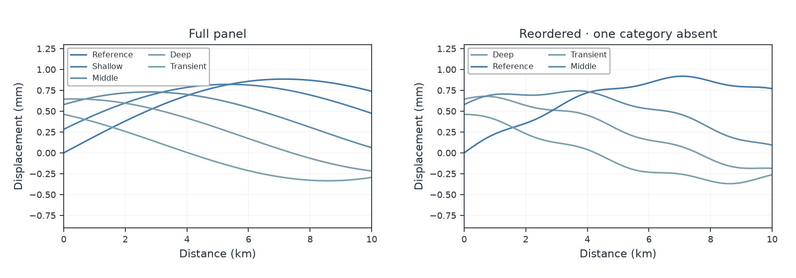
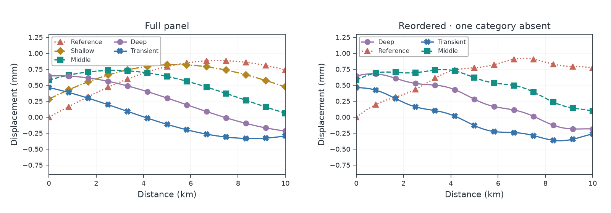

# Figure doctor

Improve an existing line or scatter figure with coordinated colors, markers
and dashes. Matplotlib, Plotly and UltraPlot are supported.

| Before | After |
| --- | --- |
|  |  |

## Compare suggestions

Install from PyPI with `python -m pip install "huevat[design,matplotlib]"`.
Replace `matplotlib` with `plotly` or `ultraplot` for those libraries.

```python
from huevat import doctor

scene = doctor.inspect(fig)
closer, separation, simple = doctor.propose(scene)
preview = doctor.preview(fig, separation)
gray = doctor.preview(fig, separation, condition="grayscale")

change = doctor.apply(fig, separation)
change.undo()
```

- **Closer** keeps more of the original color appearance.
- **Separation** prioritizes series that cross or run close together.
- **Simple** uses fewer additional markers and dashes.

Suggestions can be similar when the same choice works best for the figure.
Preview creates a copy. For Matplotlib and UltraPlot, save it with
`preview.savefig("preview.png")` or display it in a notebook. For Plotly, use
`preview.show()`. `apply` changes the original figure; `undo` restores the
previous styles and checks for changes made since the suggestion was applied.

## Keep specific colors or styles

```python
options = doctor.propose(scene, locked={
    "Reference": {"color": "#4379a3"},
    "Treatment": {"marker": "square", "dash": "dash"},
})
```

Fixed styles stay exact. If they prevent colors from passing the checks, the
report says so. Markers and dashes can still help readers follow the series.

## Keep labels consistent across figures

```python
next_scene = doctor.inspect(next_fig)
next_options = doctor.propose(next_scene, assignments=separation.assignments)
```

The same label keeps its style when series are reordered or temporarily absent.
Use consistent, unique labels for categories you want to match.

## Check and save a suggestion

```python
print(separation.report["color_screen_pass"])
gray = doctor.preview(fig, separation, condition="grayscale")
simulated = doctor.preview(fig, separation, condition="deutan-100")

saved_json = separation.to_json()
restored = doctor.load_proposal(saved_json)
```

A saved suggestion applies to the same figure data and settings. Use its
`.assignments` to carry styles to a different figure.

## Supported figures

Figure doctor edits ordinary Cartesian lines and scatter series with uniform
colors. It supports repeated labels across panels and respects each panel's
background. Images, colorbars, uncertainty bands and unsupported plot types
are kept as they are. Plotly works best with explicit numeric coordinates,
trace modes and colors. Not every legend or custom artist can be updated.

Color checks cover the supported marks. They do not assess the whole figure;
crossing detection can miss small features. Review the preview at the intended
figure size. The [methods notes](METHODS_H4C.md) give detailed coverage.
