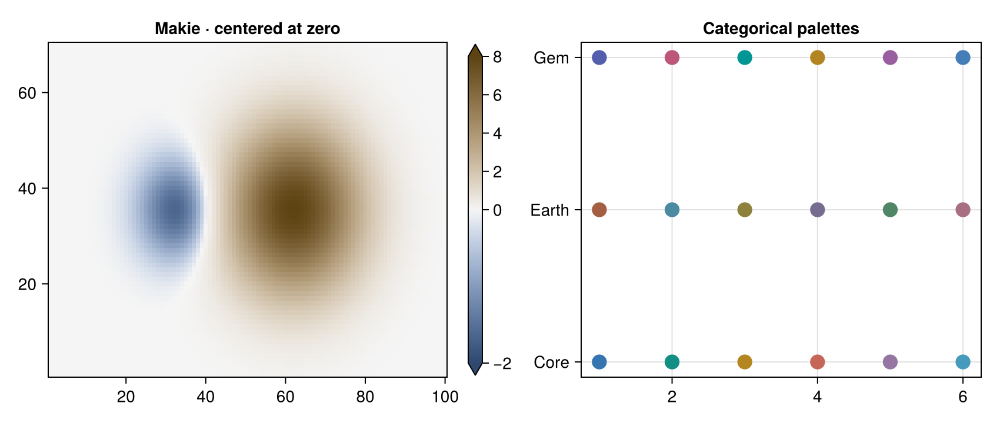
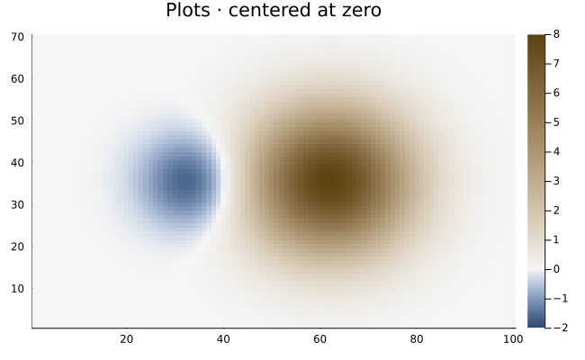

# Julia: Makie.jl and Plots.jl

Huevat includes a native Julia package. It reads the same checked colors and
cubic gradient paths as Python; Python is not needed to make Julia figures.
Custom palette generation and Figure doctor currently remain Python features.

## Install from this checkout

In Julia, with the repository as your working directory:

```julia
using Pkg
Pkg.activate("julia/examples")
Pkg.develop(path="julia/Huevat")
Pkg.instantiate()
```

The example environment includes CairoMakie and Plots. The base Huevat package
loads neither plotting library. Julia 1.10+ is supported.

## Categories and gradients

```julia
using Huevat

colors = Huevat.categorical(6; style=:core)
earth = Huevat.categorical(6; style=:earth, background=:dark)
gem = Huevat.categorical(6; style=:gem)
by_label = Huevat.color_map(colors, ["A", "B", "C", "D", "E", "F"])

g = Huevat.gradient(:diverging)
Huevat.at(g, 0.5)
Huevat.discrete(g, 7)
reverse(g)
Huevat.known_counts(g)
```

Use `:sequential`, `:multihue`, `:spectral`, `:cyclic` or any of the eighteen
named gradients, such as `:bathymetry`.
Append `_r` to reverse or `_d` for the dark variant, such as `:thermal_d_r`.
Discrete sampling lists prepared
passing counts; new searches remain available in Python. Core covers 2–12
categories, Earth and Gem 2–8, each on light and dark backgrounds.

## Makie



```julia
using Huevat, CairoMakie

data = [sin(x) * cos(y) for x in range(-3, 3; length=100),
                              y in range(-2, 2; length=80)]
g = Huevat.gradient(:diverging)
fig = Figure()
ax = Axis(fig[1, 1])
image = heatmap!(ax, data; Huevat.makie(g; limits=(-1, 1), center=0)...)
Colorbar(fig[1, 2], image)
save("makie.png", fig)
```

The adapter preserves a specified center even for an asymmetric range such as
`limits=(-2, 8)`. It returns ordinary Makie options, so you can also use it with
other scalar plots. `missing`, `under` and `over` choose special-value colors.

## Plots



```julia
using Huevat
import Plots

g = Huevat.gradient(:diverging)
p = Plots.heatmap(data; Huevat.plots(g; limits=(-1, 1), center=0)...)
Plots.savefig(p, "plots.png")

Plots.plot([sin.(1:10), cos.(1:10)]; palette=Huevat.categorical(2))
```

The returned gradient uses explicit color positions to retain the chosen
physical center. Plots uses its normal missing-data and endpoint behavior.

Run `julia --project=julia/examples julia/examples/render.jl` for both native
examples. The implementation follows [Makie's color options](https://docs.makie.org/stable/explanations/colors.html)
and [Plots' gradient positions](https://docs.juliaplots.org/stable/generated/colorschemes/).
