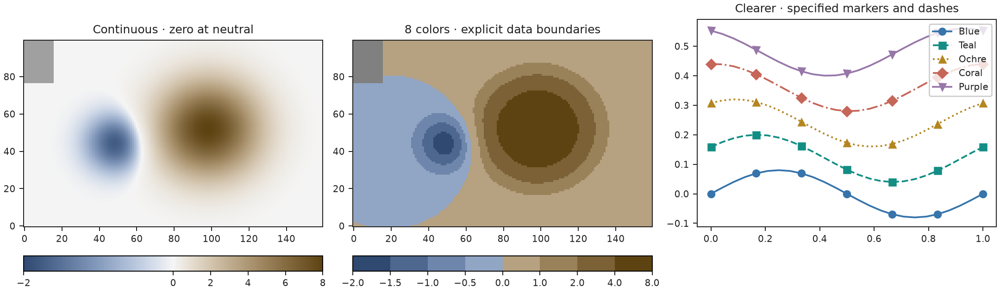
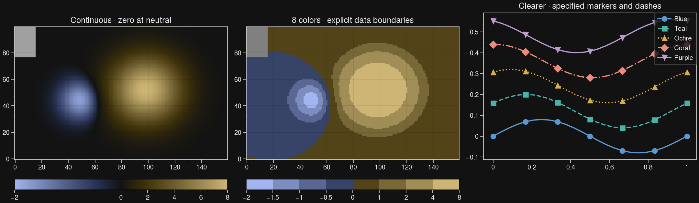
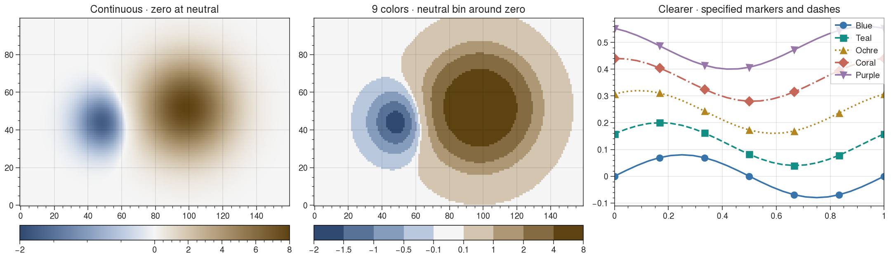

# Plotting examples

Use the same Huevat palettes with Matplotlib, Plotly and UltraPlot.
Install from PyPI with the extra for your plotting library, such
as `python -m pip install "huevat[matplotlib]"`.

## Matplotlib



```python
import numpy as np
import matplotlib.pyplot as plt
import huevat as hv
from huevat.adapters import matplotlib as hmpl

x = np.linspace(0, 10, 100)
z = np.linspace(-2, 8, 120).reshape(10, 12)
palette = hv.categorical(5)
gradient = hv.diverging()

fig, axes = plt.subplots(1, 2, figsize=(9, 3), layout="constrained")
for i, color in enumerate(palette.colors):
    axes[0].plot(x, np.sin(x / 2 + i / 3), color=color, label=f"Series {i + 1}")
axes[0].legend()
image = axes[1].imshow(z, cmap=hmpl.colormap(gradient),
                       norm=hmpl.normalizer(-2, 8, center=0))
fig.colorbar(image, ax=axes[1], label="Anomaly (K)")
plt.show()
```

The neutral color represents zero, including when the negative and positive
ranges differ. For a dark figure, request `background="dark"` when choosing
both the palette and gradient, and set the figure background accordingly.



## Plotly

```python
import huevat as hv
import plotly.graph_objects as go
from huevat.adapters import plotly as hplotly

gradient = hv.diverging()
fig = go.Figure(go.Heatmap(
    z=[[-2, -1, 0], [1, 4, 8]],
    coloraxis="coloraxis",
))
fig.update_layout(coloraxis=hplotly.coloraxis(gradient, -2, 8, center=0))
fig.show()
```

Run this in Python or a notebook for the interactive figure. To share it as a
standalone file, use `fig.write_html("figure.html")`.

## UltraPlot



```python
import numpy as np
import ultraplot as uplt
import huevat as hv
from huevat.adapters import ultraplot as huplt

gradient = hv.diverging()
z = np.linspace(-2, 8, 120).reshape(10, 12)
fig, ax = uplt.subplots()
image = ax.pcolormesh(z, cmap=huplt.colormap(gradient),
                      norm=huplt.normalizer(-2, 8, center=0), discrete=False)
ax.colorbar(image, label="Anomaly (K)")
uplt.show()
```

Pass `discrete=False` for a continuous field. For separate bins, use
`gradient.discrete()` for the default nine colors and the adapter's
`boundary_normalizer(palette, edges)`. The `edges` are your data thresholds;
put zero inside the central bin to display its neutral color. The gallery uses
`[-2, -1.5, -1, -.5, -.1, .1, 1, 2, 4, 8]`.

## Run the example script

From the project folder:

```sh
python examples/quickstart.py --backend matplotlib
python examples/quickstart.py --backend plotly
python examples/quickstart.py --backend ultraplot
```

The script saves figures, Plotly JSON and color files under `artifacts/quickstart`.
To redraw the README's palette images, run `python examples/gallery.py`.

[Palette gallery](../README.md) · [Quick start](../docs/QUICKSTART.md) ·
[Figure doctor](../docs/FIGURE_DOCTOR.md)
